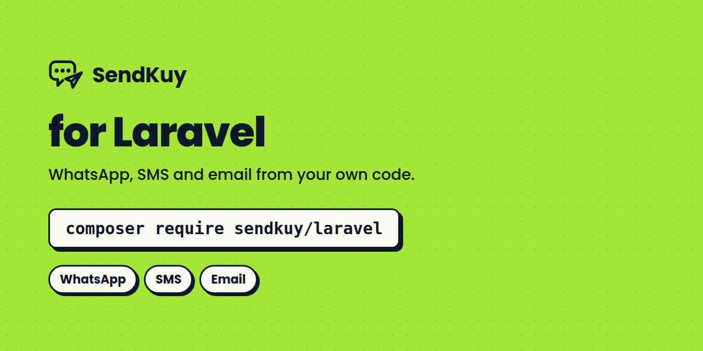

<p align="center">
  
</p>

# SendKuy for Laravel

Notifikasi WhatsApp, SMS, dan email untuk Laravel, facade untuk seluruh API SendKuy, dan webhook bertanda tangan yang sampai sebagai event Laravel.

[Read in English](README.md)

## Yang bisa kamu kirim

- **WhatsApp** dari nomor yang tersambung lewat kode QR, [ekstensi Chrome SendKuy WA Gateway](https://chromewebstore.google.com/detail/sendkuy-wa-gateway/kdopgnbocfeoehhjbolfmibnmoicdofc), atau WhatsApp Cloud API ([API WhatsApp](https://sendkuy.com/channels/whatsapp?utm_source=readme&utm_medium=sdk&utm_campaign=sendkuy-laravel)).
- **SMS** lewat HP Android dengan aplikasi SendKuy Gateway, atau provider SMS ([SMS gateway](https://sendkuy.com/channels/sms?utm_source=readme&utm_medium=sdk&utm_campaign=sendkuy-laravel)).
- **Email** dari domain kamu sendiri ([API email](https://sendkuy.com/channels/email?utm_source=readme&utm_medium=sdk&utm_campaign=sendkuy-laravel)).
- **Kode OTP** lewat `SendKuy::verifications()`, dengan cadangan dari WhatsApp ke SMS.
- **Notifikasi Laravel** lewat channel `sendkuy`, tidak pernah terkirim dobel saat job antrean diulang.
- **Percakapan dua arah** untuk helpdesk: pesan masuk tiba sebagai event `WebhookReceived`.

## Instalasi

```bash
composer require sendkuy/laravel
```

Butuh Laravel 12 atau 13 dan PHP 8.2 ke atas. Tambahkan API key ke `.env`:

```env
SENDKUY_API_KEY=sk_live_...
```

## Kirim dari mana saja

```php
use SendKuy\Laravel\Facades\SendKuy;

SendKuy::messages()->send([
    'channel' => 'whatsapp',
    'to' => ['+6281234567890'],
    'body' => 'Pesanan kamu sedang dikirim.',
]);
```

## Notifikasi

```php
public function via(object $notifiable): array
{
    return ['sendkuy'];
}

public function toSendKuy(object $notifiable): SendKuyMessage
{
    return SendKuyMessage::whatsapp('Pesanan #1042 sedang dikirim.');
}
```

Di model, tentukan tujuannya:

```php
public function routeNotificationForSendKuy(Notification $notification): string
{
    return $this->phone;
}
```

Notifikasi yang memakai `ShouldQueue` lalu diulang (worker mati atau job timeout) **tidak pernah terkirim dobel**: idempotency key-nya diturunkan dari ID notifikasi Laravel, yang sama di setiap pengulangan job. Syaratnya, `toSendKuy()` harus deterministik: susun pesan dari data notifikasi itu sendiri, jangan dari `now()`. Kalau pengulangan menghasilkan isi yang berbeda dengan key yang sama, API menolaknya dengan `409 idempotency_key_reused` dan job gagal, bukan mengirim dua kali. Untuk menjadwalkan, simpan waktunya di notifikasi saat dibuat lalu berikan ke `scheduleAt()`.

## Pakai SendKuy sebagai mailer Laravel

Semua email Laravel (mailable, notifikasi lewat channel `mail`, reset password, verifikasi email) bisa dikirim lewat SendKuy. Tambahkan mailer di `config/mail.php`:

```php
'mailers' => [
    'sendkuy' => [
        'transport' => 'sendkuy',
        'gateway_id' => env('SENDKUY_MAIL_GATEWAY_ID'),
    ],
],
```

lalu jadikan bawaan di `.env`:

```dotenv
MAIL_MAILER=sendkuy
MAIL_FROM_ADDRESS=halo@domainkamu.com
MAIL_FROM_NAME="Aplikasimu"
```

Transport ini memakai `SENDKUY_API_KEY` yang sama dengan bagian lain paket ini.

**Alamat pengirim milik gateway.** SendKuy mengirim dari alamat gateway email di dasbormu, jadi `MAIL_FROM_ADDRESS` harus sama dengan alamat dan domain gateway itu. `MAIL_FROM_NAME`, atau nama di `from` sebuah mailable, menjadi nama yang dilihat penerima. Isi `gateway_id` dengan id `gw_` gateway itu supaya email selalu lewat sana dan tidak pernah dipindah ke pengirim lain. Kalau dikosongkan, SendKuy memilih di antara pengirim email kamu yang aktif, dan pengirim bersama SendKuy bila paketmu meminjamkannya. Alamat pengirim bersama itu bukan milikmu.

**Yang dikirim.** Semua penerima `To`, subject, dan bagian HTML (atau bagian teks, di-escape dengan baris barunya dipertahankan, bila tidak ada HTML). `Reply-To` pertama menjadi alamat balasan; tanpa itu, balasan masuk ke alamat pengirim, jadi alamat `no-reply@` berarti balasan hilang. `List-Unsubscribe` dan `List-Unsubscribe-Post` ikut diteruskan, jadi newsletter bisa membawa tombol berhenti langganan satu klik milikmu sendiri; header lain tidak dikirim. Setiap email dikirim sebagai `transactional`: persis seperti hasil render, tanpa pelacakan buka atau klik, dan tanpa link berhenti langganan dari SendKuy.

**Yang ditolak.** `Cc`, `Bcc`, penerima yang hanya ada di envelope, dan berkas lampiran atau gambar tertanam melempar `TransportException` sebelum apa pun terkirim. API SendKuy menerima lampiran berupa URL, jadi tautkan berkasnya. Pesan yang gagal, `insufficient_credits`, `no_sender_available`, dan galat API lain melempar `TransportException` beserta kode galat dan id pesannya, supaya job mail yang di-queue gagal dan bisa dicoba ulang.

### Terkirim dua kali

Setiap email membawa idempotency key:

- header `X-SendKuy-Idempotency-Key` bila emailnya punya (header itu sendiri tidak ikut terkirim);
- untuk notifikasi, key dari id notifikasi dan penerimanya, dipasang otomatis. Notifikasi yang di-queue lalu diulang tidak pernah terkirim dua kali;
- selain itu, Message-ID email. Symfony membuat Message-ID baru di setiap percobaan, jadi ini hanya melindungi saat SDK mengulang request, bukan saat queue mengulang job. Beri mailable yang di-queue key-nya sendiri:

```php
public function headers(): Headers
{
    return new Headers(text: ['X-SendKuy-Idempotency-Key' => 'order-'.$this->order->id.'-shipped']);
}
```

SendKuy mengingat sebuah key selama 24 jam. Percobaan ulang yang key-nya sudah mengirim email, termasuk bila body-nya dirender berbeda (misalnya link bertanda tangan dengan masa berlaku baru), dianggap sudah terkirim dan tidak melempar exception.

Key notifikasi hanya dipasang bila mailer yang mengirim email itu langsung memakai transport `sendkuy`. Mailer `failover` atau `roundrobin` yang membungkus `sendkuy` tidak mendapat key otomatis, jadi notifikasi yang di-queue lalu diulang bisa terkirim dua kali. Pasang `X-SendKuy-Idempotency-Key` sendiri, atau jadikan `sendkuy` mailer-nya langsung.

### Batas laju

Satu email adalah satu request API, jadi notifikasi dalam jumlah besar akan bertemu batas request per menit paketmu (bawaan 60). Request yang melewati batas melempar `TransportException`; pasang `$tries` dan `$backoff` di job mail supaya dicoba lagi nanti.

## Webhook

Paket ini mendaftarkan `POST /sendkuy/webhook`. Simpan secret-nya di `.env`:

```env
SENDKUY_WEBHOOK_SECRET=whsec_...
```

Setiap kiriman dengan signature valid menjadi event `SendKuy\Laravel\Events\WebhookReceived`. Kalau `SENDKUY_WEBHOOK_SECRET` belum diisi, rute menjawab `500` dan mencatat error, sehingga masalahnya terlihat di riwayat pengiriman webhook dasbor SendKuy. Pasang listener `ShouldQueue` supaya rute menjawab dalam 10 detik, dan pakai `$event->id` untuk melewati kiriman ganda.

Event `message.received` membawa pengirim (`from`), channel, nomor yang menerimanya, dan media bila ada. Kalau akunmu meneruskan pesan masuk ke webhook saja, pesannya tidak disimpan di SendKuy, jadi `id` dan `conversation_id` bernilai `null`: balas dengan `SendKuy::messages()->send()` ke `$event->data['from']` di `$event->data['channel']`.

Panduan lengkap ada di [README bahasa Inggris](README.md) dan [docs.sendkuy.com/laravel](https://docs.sendkuy.com/laravel?utm_source=readme&utm_medium=sdk&utm_campaign=sendkuy-laravel).

## Lisensi

MIT.
