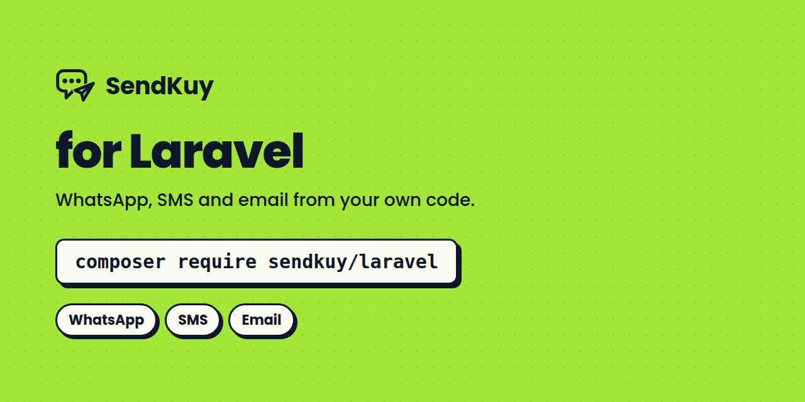

<p align="center">
  <a href="https://sendkuy.com/?utm_source=readme&utm_medium=sdk&utm_campaign=sendkuy-laravel">
    
  </a>
</p>

# SendKuy for Laravel

WhatsApp, SMS and email notifications for Laravel, a facade for the whole SendKuy API, and signed webhooks that arrive as Laravel events.

[](https://packagist.org/packages/sendkuy/laravel)
[](https://packagist.org/packages/sendkuy/laravel)
[](https://github.com/sendkuy/sendkuy-laravel/actions/workflows/ci.yml)
[](LICENSE)

[Baca dalam Bahasa Indonesia](README.id.md)

## What you can send

- **WhatsApp** from a number connected by QR code, the [SendKuy WA Gateway Chrome extension](https://chromewebstore.google.com/detail/sendkuy-wa-gateway/kdopgnbocfeoehhjbolfmibnmoicdofc), or the WhatsApp Cloud API ([WhatsApp API](https://sendkuy.com/channels/whatsapp?utm_source=readme&utm_medium=sdk&utm_campaign=sendkuy-laravel)).
- **SMS** through an Android phone running SendKuy Gateway, or an SMS provider ([SMS gateway](https://sendkuy.com/channels/sms?utm_source=readme&utm_medium=sdk&utm_campaign=sendkuy-laravel)).
- **Email** from your own domain ([email API](https://sendkuy.com/channels/email?utm_source=readme&utm_medium=sdk&utm_campaign=sendkuy-laravel)).
- **OTP codes** with `SendKuy::verifications()`, falling back from WhatsApp to SMS.
- **Laravel notifications** through the `sendkuy` channel, never sent twice when a queued job retries.
- **Every Laravel email** through the `sendkuy` mail transport, with `MAIL_MAILER=sendkuy`.
- **Two-way conversations** for your helpdesk: incoming messages arrive as `WebhookReceived` events.

## Install

```bash
composer require sendkuy/laravel
```

Laravel 12 or 13, PHP 8.2 or newer. Add your key to `.env`:

```env
SENDKUY_API_KEY=sk_live_...
```

## Send from anywhere

```php
use SendKuy\Laravel\Facades\SendKuy;

$messages = SendKuy::messages()->send([
    'channel' => 'whatsapp',
    'to' => ['+6281234567890'],
    'body' => 'Your order is on its way.',
]);
```

Prefer injection? Type-hint `SendKuy\SendKuy` and Laravel hands you the same configured client. Every endpoint of the API has a method; see the [PHP SDK](https://github.com/sendkuy/sendkuy-php) for the full list, errors and pagination.

## Notifications

```php
use Illuminate\Notifications\Notification;
use SendKuy\Laravel\Notifications\SendKuyMessage;

class OrderShipped extends Notification
{
    public function via(object $notifiable): array
    {
        return ['sendkuy'];
    }

    public function toSendKuy(object $notifiable): SendKuyMessage
    {
        return SendKuyMessage::whatsapp('Order #1042 is on its way.')
            ->media('https://example.com/receipts/1042.pdf', 'document');
    }
}
```

Tell the channel where to send by adding a method to your notifiable model:

```php
public function routeNotificationForSendKuy(Notification $notification): string
{
    return $this->phone; // +6281234567890
}
```

Or send without a model:

```php
Notification::route('sendkuy', '+6281234567890')->notify(new OrderShipped);
```

| Builder | Sets |
| --- | --- |
| `SendKuyMessage::whatsapp($body)`, `::sms($body)`, `::email($subject, $body)` | the channel and the text |
| `->template($id, $parameters)` | a WhatsApp template |
| `->media($url, $type, $filename)` | one WhatsApp attachment: `image`, `video`, `audio` or `document` |
| `->attach($url, $filename)` | an email attachment, up to ten |
| `->gateway($id)` | the exact sender to use |
| `->scheduleAt($dateTime)` | send later |

### A retried queued notification is never sent twice

When a notification implements `ShouldQueue`, Laravel retries its job if a worker dies or the job times out. The channel derives the idempotency key from Laravel's notification id, which stays the same across every retry of that job, so SendKuy answers a retry with the first result instead of sending the message again.

Keep `toSendKuy()` deterministic for this to hold: build the message from the notification's own data, not from `now()` or other values that change between runs. A retry that produces a different payload under the same key is refused with `409 idempotency_key_reused`, so the job fails instead of sending twice. To schedule, store the time on the notification when you create it and pass that to `scheduleAt()`.

A refusal is not remembered. When SendKuy refuses the send, for example with `insufficient_credits` or `no_sender_available`, nothing went out, so a retry of the job under the same key runs the send again: once you top up or connect a sender, the next retry goes through. A send whose every message failed because of its sender is not remembered either; a failure that may already have reached the recipient, such as a provider timeout, stays remembered. Retrying also helps with `429` and server errors: a retry under the same key either runs again or returns the message that already went out.

The channel returns the created messages, so a `NotificationSent` listener can store their ids from `$event->response`.

## Use SendKuy as your Laravel mailer

Send every Laravel email (mailables, notifications through the `mail` channel, password resets, email verification) through SendKuy by adding a mailer to `config/mail.php`:

```php
'mailers' => [
    'sendkuy' => [
        'transport' => 'sendkuy',
        'gateway_id' => env('SENDKUY_MAIL_GATEWAY_ID'),
    ],
],
```

and setting it as the default in `.env`:

```dotenv
MAIL_MAILER=sendkuy
MAIL_FROM_ADDRESS=hello@your-domain.com
MAIL_FROM_NAME="Your App"
```

The transport uses the same `SENDKUY_API_KEY` as the rest of the package.

**The sender address belongs to the gateway.** SendKuy sends from the address of the email gateway in your dashboard, so `MAIL_FROM_ADDRESS` must match that gateway's address and domain. `MAIL_FROM_NAME`, or the name on a mailable's `from`, becomes the name recipients see. Set `gateway_id` to the `gw_` id of that gateway to always send through it; such an email is never moved to another sender. Left empty, SendKuy picks among your live email senders and, when your plan lends them, SendKuy's shared senders, whose address is not yours.

**What is sent.** Every `To` recipient, the subject, and the HTML part (or the text part, escaped with its line breaks kept, when there is no HTML). The first `Reply-To` becomes the reply address; without one, replies go to the from address, so a `no-reply@` address means replies are lost. `List-Unsubscribe` and `List-Unsubscribe-Post` are passed on, so a newsletter can carry your own one-click unsubscribe; every other header is left out. Every email is sent as `transactional`: exactly as rendered, with no open or click tracking and no unsubscribe link from SendKuy.

**What is refused.** `Cc`, `Bcc`, recipients that are only on the envelope, and attached or embedded files throw a `TransportException` before anything is sent. The SendKuy API takes attachments as URLs, so link to a file instead. A message that fails, `insufficient_credits`, `no_sender_available` and every other API error throw a `TransportException` with the error code and message id, so a queued mail job fails and can retry.

### Sending twice

The transport sends an idempotency key with every email:

- the `X-SendKuy-Idempotency-Key` header when the email has one (the header itself is not sent);
- for a notification, a key built from the notification id and its recipients, set for you. A retried queued notification is never sent twice;
- otherwise the email's Message-ID. Symfony creates a new Message-ID on every attempt, so this only covers the SDK retrying a request, not your queue retrying the job. Give a queued mailable its own key:

```php
public function headers(): Headers
{
    return new Headers(text: ['X-SendKuy-Idempotency-Key' => 'order-'.$this->order->id.'-shipped']);
}
```

SendKuy remembers a key for 24 hours. A retry whose key already sent an email, even with a body rendered differently (a signed link with a new expiry, for example), counts as sent and does not throw.

The notification key is only added when the mailer that sends the email uses the `sendkuy` transport directly. A `failover` or `roundrobin` mailer that wraps `sendkuy` gets no automatic key, so a retried queued notification may be sent twice; set `X-SendKuy-Idempotency-Key` yourself, or make `sendkuy` the mailer itself.

### Rate limit

Each email is one API request, so a large batch of notifications meets your plan's per-minute request limit (60 by default). A request over the limit throws a `TransportException`; give queued mail jobs `$tries` and `$backoff` so they retry later.

## Webhooks

The package registers `POST /sendkuy/webhook`, outside the `web` middleware group so CSRF does not apply. Point a webhook at it in your SendKuy dashboard and store the secret:

```env
SENDKUY_WEBHOOK_SECRET=whsec_...
```

Every delivery with a valid signature becomes a `SendKuy\Laravel\Events\WebhookReceived` event; anything else is refused with `403`. If `SENDKUY_WEBHOOK_SECRET` is not set, the route answers `500` and logs an error, so the problem shows up in your SendKuy delivery history instead of passing silently.

```php
use Illuminate\Contracts\Queue\ShouldQueue;
use SendKuy\Laravel\Events\WebhookReceived;

class HandleSendKuyWebhook implements ShouldQueue
{
    public function handle(WebhookReceived $event): void
    {
        if ($event->type === 'message.received') {
            // $event->data: from, channel, body, provider_message_id
        }
    }
}
```

`$event->id` stays the same across SendKuy's retries of one delivery: use it to skip duplicates. Queue the listener so the route answers within SendKuy's 10-second timeout. New event types reach your listener without a package update.

`message.received` carries who wrote (`from`), the channel, the number that received it and any media. When your account forwards incoming messages to your webhook only, nothing is stored in SendKuy and `id` and `conversation_id` are `null`: reply with `SendKuy::messages()->send()` to `$event->data['from']` on `$event->data['channel']`.

## Configuration

```bash
php artisan vendor:publish --tag=sendkuy-config
```

| Key | Env | Default |
| --- | --- | --- |
| `api_key` | `SENDKUY_API_KEY` | none |
| `base_url` | `SENDKUY_BASE_URL` | `https://app.sendkuy.com/api/v1`; change it only to reach a proxy or a mock server in tests |
| `timeout` | `SENDKUY_TIMEOUT` | `30` seconds |
| `max_retries` | `SENDKUY_MAX_RETRIES` | `2` |
| `webhook.secret` | `SENDKUY_WEBHOOK_SECRET` | none |
| `webhook.path` | `SENDKUY_WEBHOOK_PATH` | `sendkuy/webhook`; set it to an empty value to turn the route off |
| `webhook.tolerance` | `SENDKUY_WEBHOOK_TOLERANCE` | `300` seconds |

## Testing

`Notification::fake()` works as usual. To fake the client itself, bind your own instance:

```php
$this->app->instance(\SendKuy\SendKuy::class, new \SendKuy\SendKuy('sk_test_123', ['http_client' => $fakeClient]));
```

## Links

- [Laravel guide](https://docs.sendkuy.com/laravel?utm_source=readme&utm_medium=sdk&utm_campaign=sendkuy-laravel)
- [Documentation](https://docs.sendkuy.com/?utm_source=readme&utm_medium=sdk&utm_campaign=sendkuy-laravel)
- [SendKuy](https://sendkuy.com/?utm_source=readme&utm_medium=sdk&utm_campaign=sendkuy-laravel)
- [Changelog](CHANGELOG.md)

## License

MIT. See [LICENSE](LICENSE).
